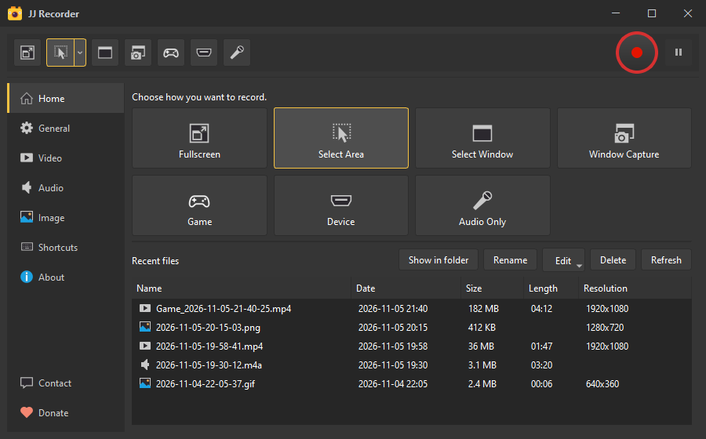
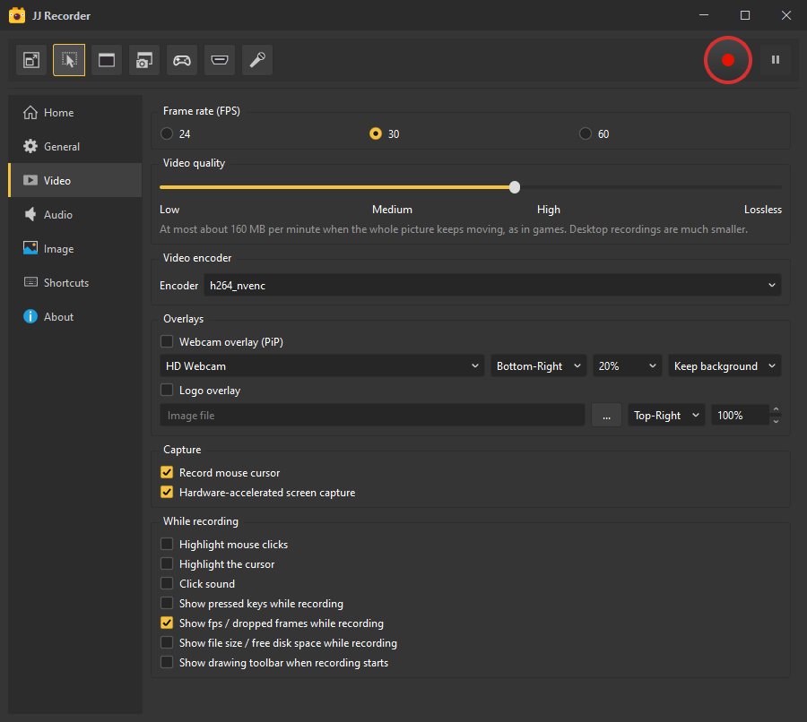
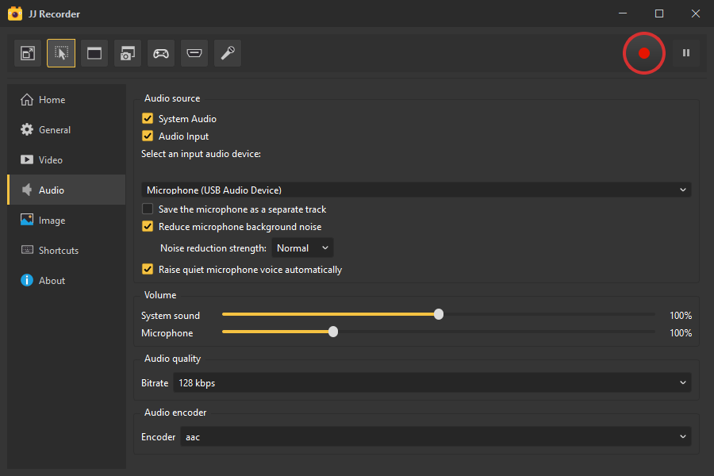
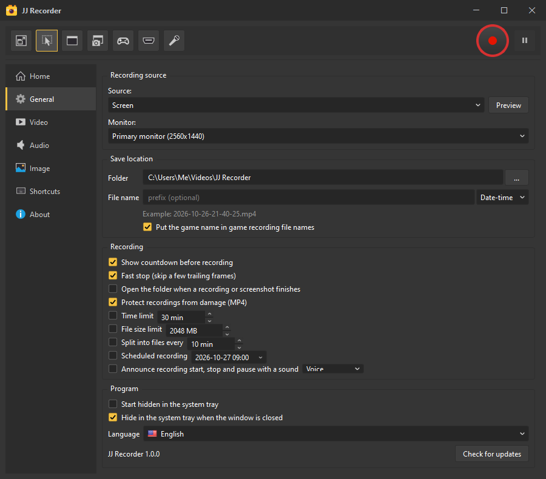
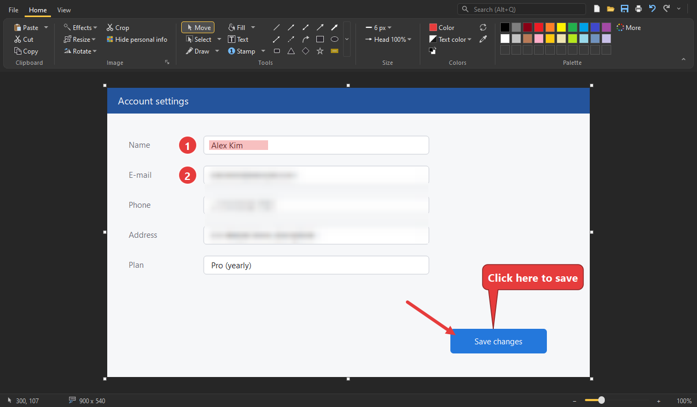

# JJ Recorder

A screen recorder for Windows. Record your screen, games and audio, take screenshots, and make quick edits to your recordings, all in one small program.

**[Download the latest version](https://github.com/hanulso78/jj-recorder-release/releases/latest)**

This repository only hosts the release files. Each release contains a zip file with the program, documentation and license information.

## Features

**Recording**
- Full screen, a selected area, a window (even when covered by other windows), games and capture devices
- Audio only recording
- GPU encoders (NVIDIA, Intel, AMD) and the encoders built into Windows, so recording uses little CPU
- Installed VfW codecs such as x264vfw, x265vfw and Xvid can also be used
- Crash-safe MP4: if the PC stops during recording, the file still plays up to that point
- Time limit, size limit, automatic file splitting and scheduled recording

**Audio**
- System sound and microphone together, with an optional separate microphone track
- Microphone noise reduction and automatic level boost for quiet voices
- Spoken or sound cues when recording starts, stops and pauses

**On screen**
- Draw on the screen while recording, and zoom in around the cursor
- Click highlights, cursor spotlight and keystroke display
- Webcam overlay with green or blue background removal, and logo overlay

**Screenshots**
- Screenshots, timed captures and scrolling capture of long pages
- Copy text from the screen (OCR)
- Image editor with arrows, callouts, numbered stamps, blur, mosaic, cropping and more

**Editing recordings**
- Trim, save as GIF, reduce file size, change playback speed, normalize loudness, extract audio and join files

Available in English, Korean, Japanese and Chinese.

## Screenshots

**Video settings**: frame rate, quality with an estimated file size, encoder and overlays

**Audio settings**: system sound and microphone, noise reduction and volume

**General settings**: save location, file names, time limits, scheduled recording and updates

**Image editor**: numbered stamps, blur, arrows and callouts on a screenshot

## Requirements

- Windows 10 (version 1903 or later) or Windows 11, 64-bit

## Install

1. Download `jj-recorder-<version>.zip` from the [latest release](https://github.com/hanulso78/jj-recorder-release/releases/latest).
2. Unzip it to any folder you can write to, for example `Documents\JJ Recorder`.
3. Run `jj-recorder.exe`. No installation is needed.

Press **F1** in the program to open the manual.

## Update

Open the **General** page and click **Check for updates**. If a new version is available, click **Update now**. The program downloads it, checks its signature and restarts. Your settings are kept.

You can also download the new zip and unzip it over the old folder.

## Uninstall

Close the program and delete its folder. Settings are stored in `%LOCALAPPDATA%\jj-recorder`; delete that folder too if you want to remove them.

## Privacy

JJ Recorder does not collect or send any usage data. It connects to the internet only when you click **Check for updates**, and then only to this GitHub repository.

## License

JJ Recorder uses open source libraries such as Qt and FFmpeg under the LGPL. The list of libraries and their license texts are in `THIRD-PARTY.txt` and the `licenses` folder inside the zip. `SOURCE-OFFER.txt` explains how to get the source code of the LGPL libraries.

## Support

JJ Recorder is free to use. If it is useful to you, you can support its development:

- **GitHub Sponsors** (card, monthly or one time): https://github.com/sponsors/hanulso78
- **Bank transfer in Korea**: KakaoBank `3333346492333` (민인학)

## Contact

Questions and feedback: inhak.min@gmail.com
